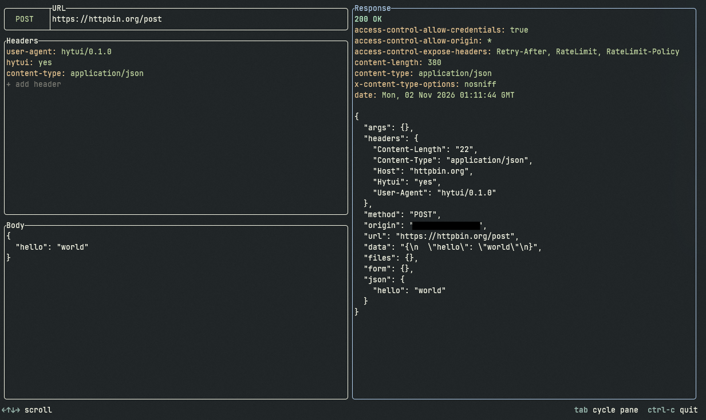

# HyTUI

A HTTP client in a TUI.



The TUI is built using the [Ratatui][ratatui] library. For HTTP we use [hyper][hyper].
For TLS, which is used for HTTPS, we use [rustls](https://github.com/rustls/rustls).
We use the [smol][smol] family of crates for the async stuff!

## Install

Download a binary for your platform from the [Releases][releases].

### Build from source

To build HyTUI from source, you need to install the [Rust toolchain][install-rust].
Afterwards, clone this repository, and run the following command to build the program:

```sh
cargo build --release
```

## How to use?

After starting the program you should see the TUI! You can press TAB to cycle
between the different panes (SHIFT+TAB to go the opposite direction).

Once you have configured your request, press CTRL+ENTER to send the request!
The response should then appear on the right.

[ratatui]: https://ratatui.rs/
[hyper]: https://hyper.rs/
[smol]: https://github.com/smol-rs
[releases]: https://github.com/lukadev-0/hytui/releases
[install-rust]: https://rust-lang.org/tools/install/
